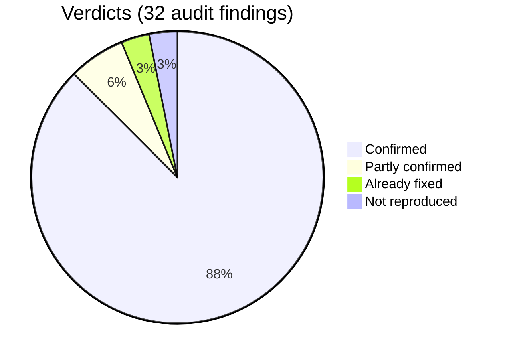
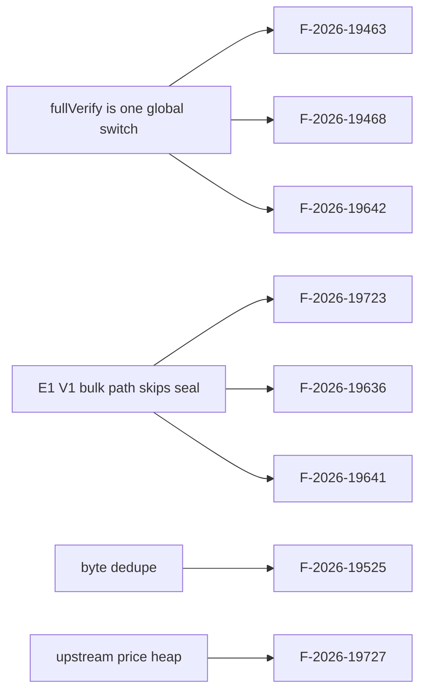
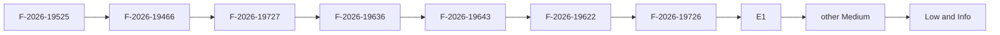

[Audit] XDPoS audit findings on v1.17.6-xdc.9 - tracking
_Text uses ASD-STE100 Simplified Technical English (about 80%): short sentences, active voice, one idea per sentence._

## What

- An external audit lists 32 findings for the XDPoS code in this fork.
- We checked each finding against v1.17.6-xdc.9 (`d5b991899`).
- We found 5 more defects during the check (E1 to E5).
- This issue tracks all of them.

## Why

- Two findings let one masternode key or one proposer break consensus safety.
- Most findings exist only in this fork. Canonical XDPoSChain is correct there.
- Every tagged release since v1.17.3-xdc.1 has F-2026-19525.

## Diagrams



## Images

No screenshots. Evidence is in each child issue.

## Prompt

```text
Work through the child issues in Flow order. One PR per issue.
Write the failing test first. Match canonical XDPoSChain unless an issue says otherwise.
```

## Workflow

- [ ] {{F-2026-19525}} [High / ours Critical] One masternode key can satisfy a quorum or timeout certificate
- [ ] {{F-2026-19727}} [High / ours High] A zero price signing transaction keeps that account out of the block
- [ ] {{F-2026-19636}} [High / ours High] Full sync canonizes a header batch that does not extend the local head
- [ ] {{F-2026-19601}} [High / ours Medium] V2 proposer seal omits header fields that change the block hash
- [ ] {{F-2026-19466}} [Medium / ours Medium-High] Epoch switch full verification trusts header validators when they are a superset of the local set
- [ ] {{F-2026-19468}} [Medium / ours Medium] Epoch switch full verification trusts header fields when the V2 snapshot is missing
- [ ] {{F-2026-19463}} [Medium / ours Medium] Snapshot heal imports new V2 headers without leader turn enforcement
- [ ] {{F-2026-19622}} [Medium / ours Medium] A vote that completes a certificate latches the next round
- [ ] {{F-2026-19726}} [Medium / ours Medium] Round timeout uses the round zero period
- [ ] {{F-2026-19643}} [Medium / ours Medium-High] Block import does not apply the address blacklist
- [ ] {{F-2026-19723}} [Medium / ours Medium] Bulk sync canonizes a block whose state root does not match execution
- [ ] {{F-2026-19460}} [Medium / ours Medium] Verified BFT forwarding can exhaust the node through unbounded goroutines
- [ ] {{F-2026-19457}} [Medium / ours Medium] Destination only special transactions skip the tip check and the slot cap
- [ ] {{F-2026-19458}} [Medium / ours Low-Medium] A compiled ethstats secret authenticates default node reporting
- [ ] {{F-2026-19608}} [Medium / ours Low] Header verification accepts a future round with no timeout certificate
- [ ] {{F-2026-19602}} [Low / ours Low-Medium] V1 checkpoint extra replaces the signer set and authorizes that sealer
- [ ] {{F-2026-19462}} [Low / ours Low] V1 checkpoint validator verification never rejects a populated validators field
- [ ] {{F-2026-19614}} [Low / ours Low] V1 full seal logs the M2 co-sign and does not reject it
- [ ] {{F-2026-19621}} [Low / ours Low] V1 checkpoint penalties are outside the seal and never checked
- [ ] {{F-2026-19641}} [Low / ours Low] NewBlock imports a V1 extension without recovering the seal
- [ ] {{F-2026-19640}} [Low / ours Low] A sealed sign-slot block submits a second signing transaction
- [ ] {{F-2026-19642}} [Low / ours Low] Bulk sync accepts a V2 block dated in the future
- [ ] {{F-2026-19724}} [Low / ours Low] A non-mainnet insert error clears bulk sync away from the tip
- [ ] {{F-2026-19469}} [Low / ours Low] Quorum certificate forensics is never invoked after processQC
- [ ] {{F-2026-19596}} [Low / ours Low] Timeout certificates count penalized signers toward the active set quorum
- [ ] {{F-2026-19612}} [Low / ours Low] Timeout gap number selects the signer set independently of the round epoch
- [ ] {{F-2026-19467}} [Low / ours Low] Block gas accounting does not bound BlockSigners transactions
- [ ] {{F-2026-19459}} [Low / ours Info] Empty transaction dispatch imports unsigned TradingState payloads without nonce
- [ ] {{F-2026-19644}} [Low / ours None] Apothem protector rewards use stake from the payout block
- [ ] {{F-2026-19471}} [Info / ours Info] FastSync auto pin trusts compiled checkpoints without quorum verification
- [ ] {{E1}} [High / ours High] V1 bulk-sync path skips the seal check entirely
- [ ] {{E3}} [Medium / ours Medium (unconfirmed)] 0x91 and 0x94 txs are not routed to ApplyEmptyTransaction
- [ ] {{E5}} [Medium / ours Medium] Data race: peer map ranged without lock in sync_xdc.go
- [ ] {{E2}} [Low / ours Low] Forged V1 checkpoint poisons checkpointCache keyed by number only
- [ ] {{E4}} [Low / ours Low] processQC returns nil on a missing proposed header without advancing the round

## Loop

For each child issue: red test, fix, green, devnet check, PR, tick the box here.

## Graph



## Layout

| Area | Main files |
|---|---|
| consensus/v2 | `consensus/XDPoS/engines/engine_v2/` |
| consensus/v1 | `consensus/XDPoS/xdpos.go`, `eth/hooks/hooks.go` (`engine_v1/engine.go` is dead code) |
| sync | `eth/sync_xdc.go`, `core/blockchain.go` |
| txpool / miner | `core/txpool/`, `miner/xdpos_worker.go` |

## Flow



## Summary

| Group | Count |
|---|---|
| Confirmed | 28 |
| Partly confirmed | 2 |
| Already fixed | 1 |
| Not reproduced | 1 |
| Extra (found in review) | 5 |

Proof: F-2026-19525 and F-2026-19622 by unit test. All others by code reading.

## Not for submission

These two findings were validated and withdrawn from the submission list.
Evidence, commands and test output: `docs/REJECTED-FINDINGS-VALIDATION.md`.

- {{F-2026-19725}} [Info / ours None] Protector ranking uses a stable sort on equal stake
  - **Already fixed.** The stable sort was real, in `eth/hooks/engine_v2_hooks.go`.
    Commit `e0354d66b` (PR #1396, 2026-09-30) removed it, two weeks before the audit
    report. Filed and closed as COMPLETED on GitHub as #1474.
  - Note: `docs/AUDIT-v1.17.6-CHECKLIST.md` records this as "claim wrong / not
    reproduced". That reason is incorrect; the decision is not.
- {{F-2026-19609}} [Medium / ours Info] The vote lock is the parent certificate, so a certified block is not locked
  - **Intended behavior, inherited from canonical.** The fork and XDPoSChain
    v2.9.2 are functionally identical, and canonical documents it:
    "lockQuorumCert is the parent of highestQC". Standard chained-HotStuff
    two-chain lock with three-chain commit. Open on GitHub as #1468.
