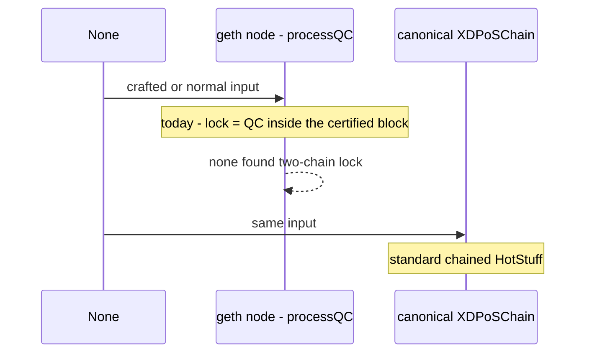
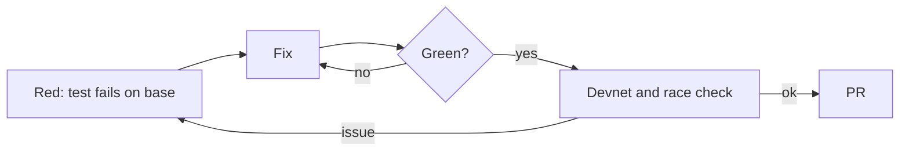
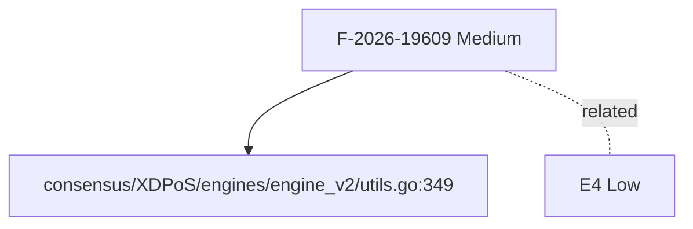
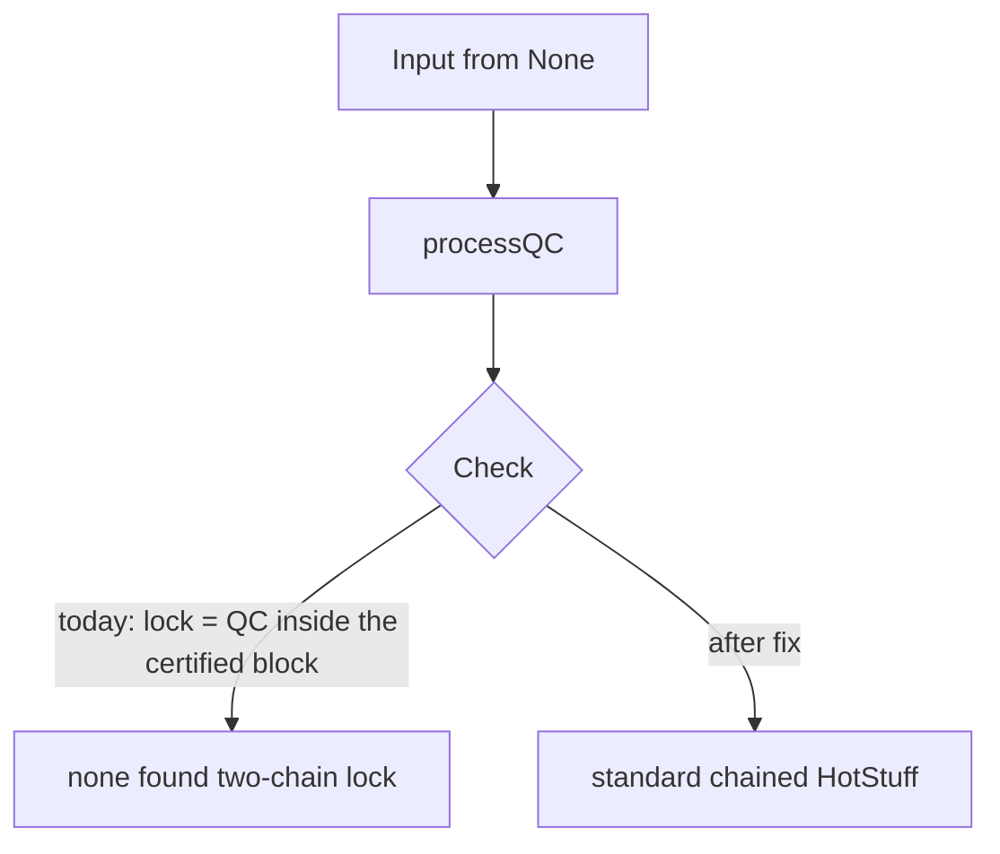

[F-2026-19609][Medium] The vote lock is the parent certificate, so a certified block is not locked
_Text uses ASD-STE100 Simplified Technical English (about 80%): short sentences, active voice, one idea per sentence._

## What

- processQC sets lockQuorumCert to the QC inside the certified block header.
- So the lock is on the parent of the certified block.
- This is the chained HotStuff two-chain lock with a three-chain commit.

## Why

- We found no safety break.
- Separate geth difference: processQC returns nil on a missing header and does not advance (see E4).

## Diagrams



## Images

No screenshots. Logs and evidence are text, as the bug template asks.

Evidence is code locations. See **Layout**.

## Prompt

Copy this prompt to a coding agent:

```text
Repo: XDCIndia/go-ethereum, base v1.17.6-xdc.9 (d5b991899).
Task: fix F-2026-19609 - The vote lock is the parent certificate, so a certified block is not locked.
Defect: lock = QC inside the certified block. Result today: none found (two-chain lock).
Target behaviour: standard chained HotStuff.
Reference: canonical XDPoSChain - Identical (engine.go:937).
Start at: consensus/XDPoS/engines/engine_v2/utils.go:349.
Steps:
  1. No fix. Close as by design, or keep for documentation.
Test first: None.
Rules: write the failing test first. Keep the change small.
Match canonical XDPoSChain behaviour unless the issue says otherwise.
Run: go test ./consensus/... ./core/... ./eth/... ./miner/... -count=1
```

## Workflow

- [ ] Reproduce: write the test in **Loop** step 1. Confirm it fails on v1.17.6-xdc.9 (`d5b991899`).
- [ ] No fix. Close as by design, or keep for documentation.
- [ ] Run the package tests and the full suite.
- [ ] Open a PR that links this issue. Add `Closes #<this issue>`.
- [ ] Update `docs/AUDIT-v1.17.6-CHECKLIST.md` in ItWorksinMyLocal.

## Loop

1. **Red** - None.
2. **Fix** - apply the steps in **Workflow**.
3. **Green** - the new test passes. The old tests pass.
4. **Guard** - run with `-race` and on a devnet. Repeat from 1 if a test fails.



## Graph



Related: E4 (links in the tracking issue).

## Layout

| File : line | Role |
|---|---|
| `consensus/XDPoS/engines/engine_v2/utils.go:349` | lockQuorumCert |

Canonical reference (XDPoSChain `68b00c7e5`): Identical (engine.go:937).

## Flow



## Summary

| Field | Value |
|---|---|
| Audit ID | F-2026-19609 |
| Severity (audit / ours) | Medium / Info |
| Verdict | CONFIRMED (by design) |
| Matches audit title | Narrower (not a bug) |
| Origin | Inherited |
| Proof | Code reading |
| Area | `consensus/v2` |
| Checked on | v1.17.6-xdc.9 (`d5b991899`), compared with XDPoSChain `68b00c7e5` |

---
_Verified by code review against v1.17.6-xdc.9 (`d5b991899`). Source: external audit list F-2026-19xxx and local review._
