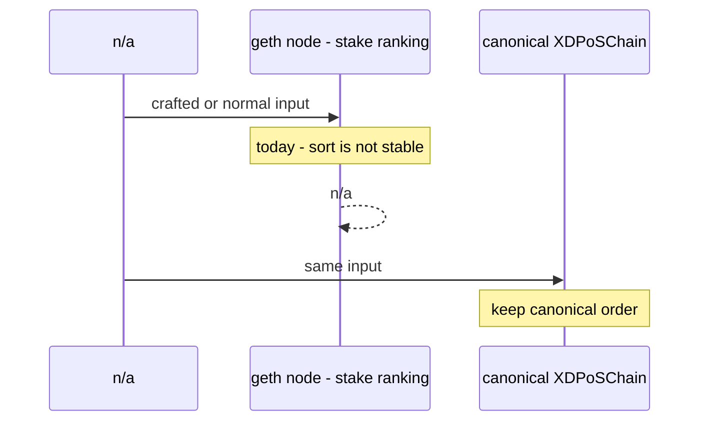
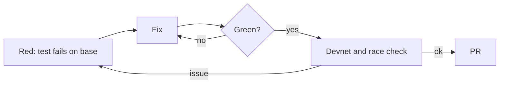
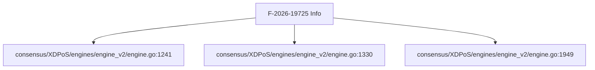
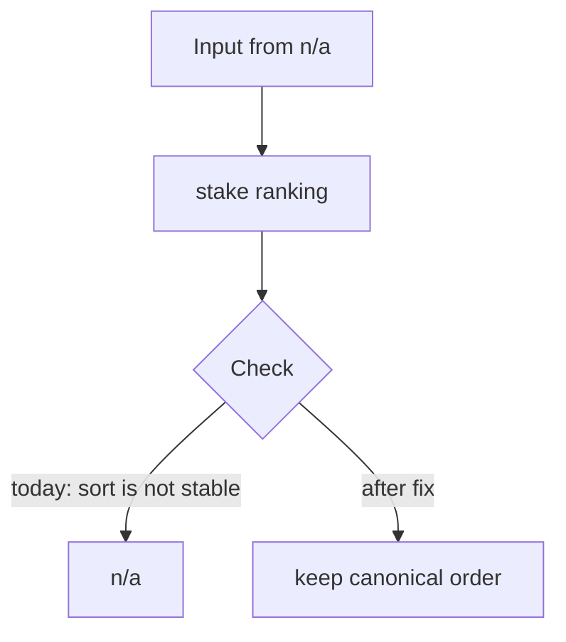

[F-2026-19725][Info] Protector ranking uses a stable sort on equal stake
_Text uses ASD-STE100 Simplified Technical English (about 80%): short sentences, active voice, one idea per sentence._

## What

- Ranking uses xdc_sort.Slice, an unstable quicksort.
- The comparator is the same as canonical.

## Why

- Tie order must match canonical for consensus.
- Do not change it alone.

## Diagrams



## Images

No screenshots. Logs and evidence are text, as the bug template asks.

Evidence is code locations. See **Layout**.

## Prompt

Copy this prompt to a coding agent:

```text
Repo: XDCIndia/go-ethereum, base v1.17.6-xdc.9 (d5b991899).
Task: fix F-2026-19725 - Protector ranking uses a stable sort on equal stake.
Defect: sort is not stable. Result today: n/a.
Target behaviour: keep canonical order.
Reference: canonical XDPoSChain - Same sort and comparator (core/blockchain.go:2838).
Start at: consensus/XDPoS/engines/engine_v2/engine.go:1241, consensus/XDPoS/engines/engine_v2/engine.go:1330, consensus/XDPoS/engines/engine_v2/engine.go:1949.
Steps:
  1. None. Close.
Test first: None.
Rules: write the failing test first. Keep the change small.
Match canonical XDPoSChain behaviour unless the issue says otherwise.
Run: go test ./consensus/... ./core/... ./eth/... ./miner/... -count=1
```

## Workflow

- [ ] Reproduce: write the test in **Loop** step 1. Confirm it fails on v1.17.6-xdc.9 (`d5b991899`).
- [ ] None. Close.
- [ ] Run the package tests and the full suite.
- [ ] Open a PR that links this issue. Add `Closes #<this issue>`.
- [ ] Update `docs/AUDIT-v1.17.6-CHECKLIST.md` in ItWorksinMyLocal.

## Loop

1. **Red** - None.
2. **Fix** - apply the steps in **Workflow**.
3. **Green** - the new test passes. The old tests pass.
4. **Guard** - run with `-race` and on a devnet. Repeat from 1 if a test fails.



## Graph



## Layout

| File : line | Role |
|---|---|
| `consensus/XDPoS/engines/engine_v2/engine.go:1241` | sort |
| `consensus/XDPoS/engines/engine_v2/engine.go:1330` | sort |
| `consensus/XDPoS/engines/engine_v2/engine.go:1949` | sort |

Canonical reference (XDPoSChain `68b00c7e5`): Same sort and comparator (core/blockchain.go:2838).

## Flow



## Summary

| Field | Value |
|---|---|
| Audit ID | F-2026-19725 |
| Severity (audit / ours) | Info / None |
| Verdict | NOT REPRODUCED |
| Matches audit title | No (claim wrong) |
| Origin | Same as canonical |
| Proof | Code reading |
| Area | `consensus/v2` |
| Checked on | v1.17.6-xdc.9 (`d5b991899`), compared with XDPoSChain `68b00c7e5` |

**Status:** Claim does not match the code.

---
_Verified by code review against v1.17.6-xdc.9 (`d5b991899`). Source: external audit list F-2026-19xxx and local review._
