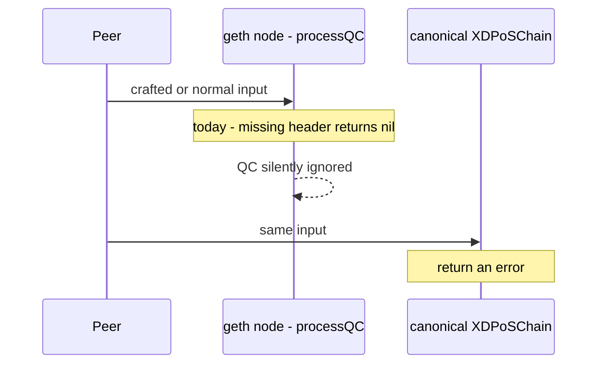
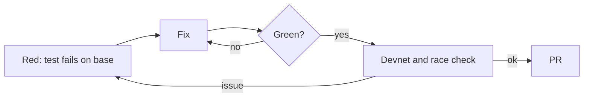
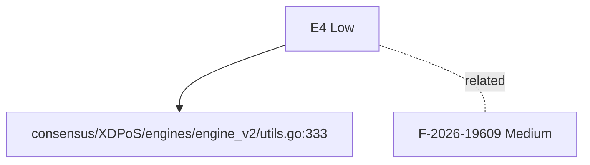
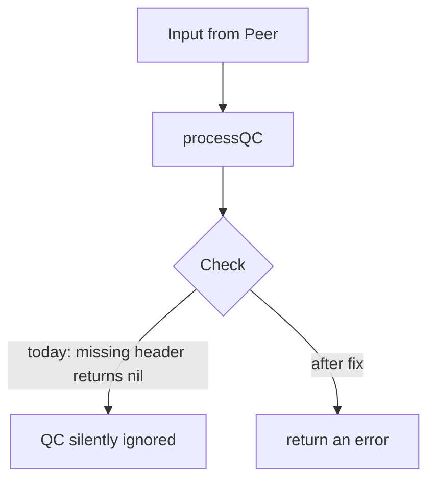

[Review E4][Low] processQC returns nil on a missing proposed header without advancing the round
_Text uses ASD-STE100 Simplified Technical English (about 80%): short sentences, active voice, one idea per sentence._

## What

- processQC returns nil when the proposed header is missing.
- It does not advance the round.
- Canonical returns an error.

## Why

- Callers think the QC was processed.
- This can hide sync problems.

## Diagrams



## Images

No screenshots. Logs and evidence are text, as the bug template asks.

Evidence is code locations. See **Layout**.

## Prompt

Copy this prompt to a coding agent:

```text
Repo: XDCIndia/go-ethereum, base v1.17.6-xdc.9 (d5b991899).
Task: fix E4 - processQC returns nil on a missing proposed header without advancing the round.
Defect: missing header returns nil. Result today: QC silently ignored.
Target behaviour: return an error.
Reference: canonical XDPoSChain - Returns an error.
Start at: consensus/XDPoS/engines/engine_v2/utils.go:333.
Steps:
  1. Return an error, as canonical does.
Test first: processQC with an unknown block hash. Expect an error.
Rules: write the failing test first. Keep the change small.
Match canonical XDPoSChain behaviour unless the issue says otherwise.
Run: go test ./consensus/... ./core/... ./eth/... ./miner/... -count=1
```

## Workflow

- [ ] Reproduce: write the test in **Loop** step 1. Confirm it fails on v1.17.6-xdc.9 (`d5b991899`).
- [ ] Return an error, as canonical does.
- [ ] Run the package tests and the full suite.
- [ ] Open a PR that links this issue. Add `Closes #<this issue>`.
- [ ] Update `docs/AUDIT-v1.17.6-CHECKLIST.md` in ItWorksinMyLocal.

## Loop

1. **Red** - processQC with an unknown block hash. Expect an error.
2. **Fix** - apply the steps in **Workflow**.
3. **Green** - the new test passes. The old tests pass.
4. **Guard** - run with `-race` and on a devnet. Repeat from 1 if a test fails.



## Graph



Related: F-2026-19609 (links in the tracking issue).

## Layout

| File : line | Role |
|---|---|
| `consensus/XDPoS/engines/engine_v2/utils.go:333` | return nil |

Canonical reference (XDPoSChain `68b00c7e5`): Returns an error.

## Flow



## Summary

| Field | Value |
|---|---|
| Audit ID | not in audit (E4) |
| Severity (audit / ours) | Low / Low |
| Verdict | FOUND IN REVIEW |
| Matches audit title | n/a (not in audit) |
| Origin | Fork only |
| Proof | Code reading |
| Area | `consensus/v2` |
| Checked on | v1.17.6-xdc.9 (`d5b991899`), compared with XDPoSChain `68b00c7e5` |

**Status:** Found during verification of the audit.

---
_Verified by code review against v1.17.6-xdc.9 (`d5b991899`). Source: external audit list F-2026-19xxx and local review._
